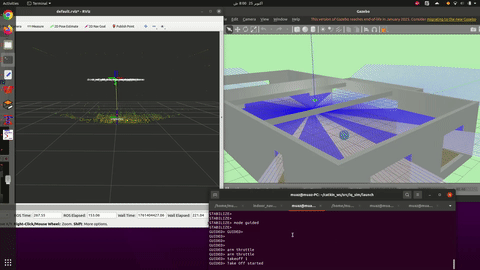
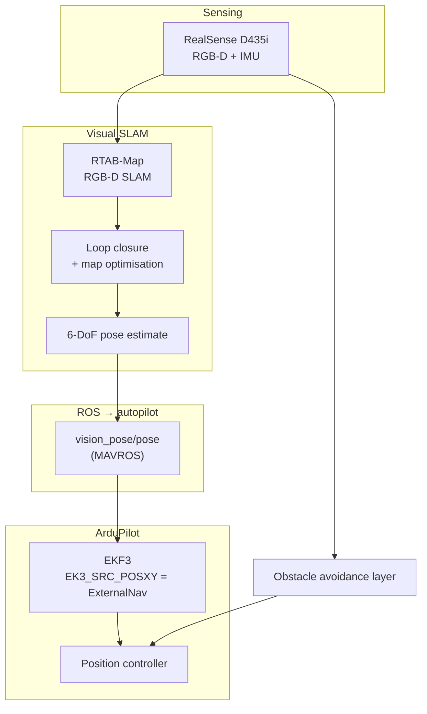

# Indoor GPS-Denied Drone Navigation — RTAB-Map Visual Odometry

Integration project: a multirotor navigating indoors with **no GPS**, using an
Intel RealSense D435i for visual odometry and RTAB-Map for SLAM, with obstacle
avoidance running on top.



▶️ **[Visual odometry demo](https://youtu.be/REPLACE_WITH_YOUR_LINK)**
▶️ **[Obstacle avoidance demo](https://youtu.be/REPLACE_WITH_YOUR_LINK)**

---

> **Scope note.** This repository documents a **systems integration**, not a
> new algorithm. RTAB-Map, the RealSense driver and MAVROS are third-party
> packages — they are referenced here, not redistributed. What this project
> contributes is the integration, configuration and flight validation of that
> stack on a real aircraft indoors.

## The problem

Indoors there is no GPS. ArduPilot's EKF needs an absolute position source or
it has nothing to anchor against, and the aircraft cannot hold position. The
fix is to feed it a vision-derived pose.

## System architecture



## How the autopilot consumes it

RTAB-Map's pose is published to MAVROS as `vision_pose/pose`. On the ArduPilot
side the EKF is told to use external navigation rather than GPS for horizontal
position:

```
EK3_SRC1_POSXY = 6     # ExternalNav
EK3_SRC1_VELXY = 6     # ExternalNav
EK3_SRC1_POSZ  = 1     # Baro (or rangefinder)
EK3_SRC1_YAW   = 1     # Compass
```

Unlike optical flow — which gives velocity only and therefore drifts without
bound — visual SLAM provides an **absolute pose within its own map frame**,
with loop closure correcting accumulated error when previously-seen places are
revisited. That is what makes sustained indoor position hold possible.

## Dependencies

Install separately — none are vendored here:

- [RTAB-Map ROS](https://github.com/introlab/rtabmap_ros)
- [realsense-ros](https://github.com/IntelRealSense/realsense-ros) (D435i)
- MAVROS + ArduPilot

## Practical notes

**Lighting and texture matter more than anything else.** Visual odometry fails
on blank walls, in low light, and against repeating patterns. Indoor flight
areas need texture to track.

**Loop closure is the whole point.** Without revisiting known places, RTAB-Map
degrades toward pure odometry and drifts like any dead-reckoning system. Plan
flight paths that re-cross earlier ground.

**Pose latency enters the control loop.** SLAM pose arrives later than IMU
data; the EKF handles this, but it bounds how aggressively the aircraft can be
flown on vision alone.

## Safety

Indoor flight leaves no room for a drift excursion. Validate pose quality in
the air while hovering manually before handing position control to the vision
stack, and keep a pilot able to take the mode switch.
